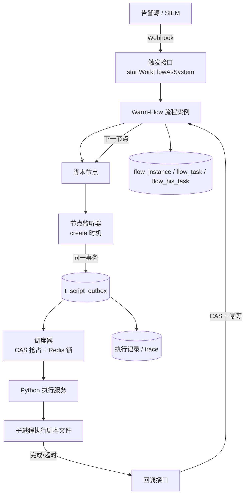
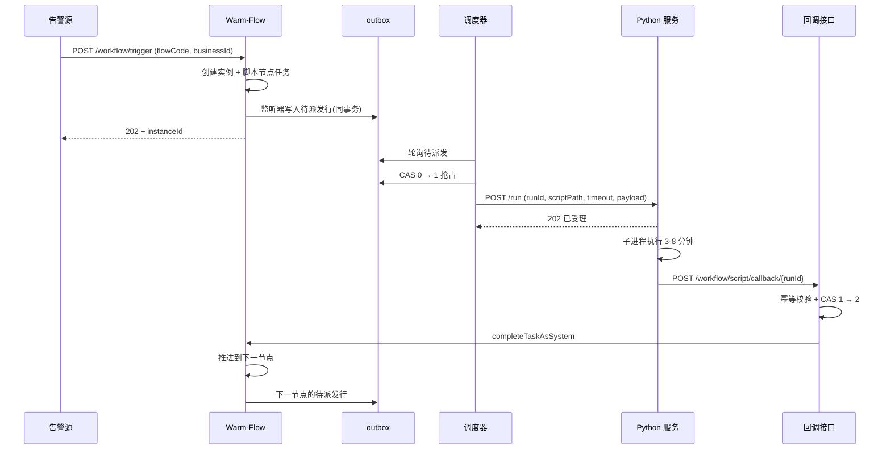

# 基于 warm-flow 的 SOAR 剧本自动执行方案

| 项       | 内容                                           |
| -------- | ---------------------------------------------- |
| 文档版本 | v1.0                                           |
| 编写日期 | 2026-11-06                                     |
| 适用模块 | `ruoyi-modules/ruoyi-workflow`                 |
| 关联模块 | `ruoyi-modules/ruoyi-aiflow`（不采用，见 3.2） |
| 文档状态 | 待评审                                         |

---

## 1. 背景与目标

### 1.1 背景

平台已经具备两套流程能力：

- `ruoyi-workflow`：基于 [Warm-Flow](https://warm-flow.dromara.org/) 的审批流，具备流程定义、版本、网关、任务、历史任务、多租户等完整能力，但设计目标是"人办的单据"。
- `ruoyi-aiflow`：基于 LangGraph4j 的图编排引擎，节点之间通过 `NodeIOData` 传递数据，具备条件分支、并行子图、HTTP 调用、SSE 流式输出，但执行模型是"一个线程跑完一次运行"。

安全运营侧的诉求是：**告警进入后自动触发对应的处置剧本**。剧本本身用 Python 编写，单次执行时间为**分钟级**，执行过程中基本没有人工介入。

### 1.2 建设目标

1. 告警通过 Webhook 进入平台后，按规则选择流程定义并自动启动。
2. 流程自动触发外部 Python 剧本，**不阻塞线程、不占用数据库事务**。
3. Python 剧本执行完成后回调平台，流程自动推进到下一节点。
4. 全链路可追溯：谁触发、跑的哪个脚本（内容哈希）、执行耗时、结果、失败原因。
5. 高危动作可插入人工审批节点（非核心路径，按需启用）。

### 1.3 范围边界

本方案**不包含**：

- Python 剧本内部的处置逻辑（由 Python 侧负责）。
- 告警接入、去重、聚合（由上游 SIEM/SOAR 前置模块负责）。
- 可视化剧本编排器（编排能力在 Python 侧，平台只做触发与记录）。
- 安全设备的连接器实现（由 Python 剧本调用）。

---

## 2. 需求

### 2.1 角色

| 角色               | 职责                                          |
| ------------------ | --------------------------------------------- |
| 安全运营工程师     | 维护流程定义与"流程节点 → 脚本"映射、启停剧本 |
| Python 开发        | 编写剧本文件、维护脚本目录                    |
| 平台管理员         | 配置系统办理人、权限、脚本白名单目录          |
| 外部系统（告警源） | 通过 Webhook 触发流程                         |

### 2.2 功能需求

| 编号  | 需求             | 说明                                                                        | 优先级 |
| ----- | ---------------- | --------------------------------------------------------------------------- | ------ |
| FR-01 | 流程与脚本映射   | 支持为"流程 + 节点"配置一个 Python 脚本路径、超时时间、启用状态             | P0     |
| FR-02 | 自动触发         | 提供 Webhook 接口，入参含流程编码与业务 ID，无需登录态                      | P0     |
| FR-03 | 异步派发         | 流程到达脚本节点时，将执行任务写入 outbox，由调度器异步派发，不阻塞流程事务 | P0     |
| FR-04 | 回调推进         | Python 回调后自动完成当前任务并推进到下一节点                               | P0     |
| FR-05 | 幂等             | 同一 `runId` 重复回调只推进一次；同一 outbox 记录不被重复派发               | P0     |
| FR-06 | 超时处理         | 脚本超过配置时长未回调，按失败处理并终止或转入兜底节点                      | P0     |
| FR-07 | 失败重试         | 派发失败按指数退避重试，超过上限标记失败                                    | P1     |
| FR-08 | 执行留痕         | 记录脚本路径、内容哈希、开始/结束时间、退出码、输出摘要、trace              | P0     |
| FR-09 | 脚本安全         | 脚本路径必须位于白名单目录内，禁止路径穿越，禁止来自接口入参                | P0     |
| FR-10 | 引擎选择         | 支持按告警类型/等级匹配流程定义                                             | P1     |
| FR-11 | 人工审批（可选） | 高危节点可插入审批任务，审批通过后继续                                      | P2     |
| FR-12 | 运行查询         | 提供按业务 ID、流程、时间、状态查询执行记录                                 | P1     |

### 2.3 非功能需求

| 维度   | 要求                                                         |
| ------ | ------------------------------------------------------------ |
| 并发   | 支持 200+ 剧本实例同时处于"等待脚本执行"状态，不占用请求线程 |
| 时延   | 从告警触发到脚本开始执行 ≤ 5 秒（不含调度轮询间隔）          |
| 可靠性 | 进程重启、多实例部署下，运行状态不丢失；派发不重复           |
| 安全   | 脚本执行面收敛到白名单目录；执行用户非 root；脚本目录只读    |
| 可观测 | 每个节点的输入、输出、耗时、状态可查；异常有告警             |
| 兼容   | 不破坏现有 `ruoyi-workflow` 审批功能与 `ruoyi-aiflow` 功能   |

---

## 3. 技术选型

### 3.1 候选方案对比

| 维度            | `ruoyi-aiflow`（LangGraph4j）                              | `ruoyi-workflow`（Warm-Flow）           |
| --------------- | ---------------------------------------------------------- | --------------------------------------- |
| 执行模型        | 一个 `@Async` 线程跑完整条流程                             | 任务驱动，任务挂起只占一行记录          |
| 分钟级等待      | ❌ 阻塞线程；改用中断则状态在内存（10 分钟 TTL）           | ✅ 任务天然持久化，等多久都行           |
| 引擎状态持久化  | ❌ 需自建（`InterruptedFlow` 为内存 `PassiveExpiringMap`） | ✅ `flow_instance` / `flow_task`        |
| 版本管理        | ❌ 需自建                                                  | ✅ `flow_definition.version`            |
| 多租户          | ❌ 无 `tenant_id`                                          | ✅ 全表 `tenant_id`                     |
| 条件分支 / 网关 | 隐式条件边                                                 | ✅ 互斥网关、并行网关、`skip_condition` |
| 节点间数据流    | ✅ `NodeIOData` + `refInputs`                              | ❌ 仅全局变量 Map                       |
| 通用 HTTP 节点  | ✅ `HttpRequestNode`                                       | ❌                                      |
| 节点配置面板    | 自由 JSON                                                  | 固定控件（5 种）                        |
| 人工审批        | 弱                                                         | ✅ 原生                                 |
| 代码归属        | 自有                                                       | 引擎为外部 jar（`org.dromara.warm`）    |

### 3.2 选型结论

**采用 `ruoyi-workflow`（Warm-Flow）作为编排底座。**

理由：

1. **执行模型匹配**。剧本为分钟级，Warm-Flow 的"任务挂起"不占线程、状态落库，重启与多实例安全；`aiflow` 的线程模型在高并发下会耗尽线程池。
2. **白拿三项能力**。版本、多租户、持久化状态机，这三项在 `aiflow` 中都需要自建（预估 10-17 人天）。
3. **数据流劣势可规避**。节点之间的数据传递由 Python 剧本内部完成，平台只在节点之间传递"告警上下文 + 上一步摘要"，不需要精细的节点 I/O 契约。

前置条件：**编排逻辑由 Python 承载，平台只做触发与记录**。若未来要求在 Java 侧做可视化动作编排，应重新评估 `aiflow`。

### 3.3 需求与 Warm-Flow 能力映射

| 需求           | Warm-Flow 机制                                | 是否需要改造            |
| -------------- | --------------------------------------------- | ----------------------- |
| 流程定义与版本 | `flow_definition` / `flow_node` / `flow_skip` | 否                      |
| 触发启动       | `InsService.start` / `startWorkFlow`          | **是**：去除登录态依赖  |
| 节点到达时派发 | `flow_node.listener_type` + `listener_path`   | 是：新增 Listener       |
| 自动推进       | `TaskService.skip`                            | 是：新增系统办理方法    |
| 超时           | 无原生支持                                    | 是：新增扫描任务        |
| 失败兜底       | `any_node_skip` / 终止任务                    | 否（配置即可）          |
| 审计           | `flow_his_task` + 自定义表                    | 是：新增 outbox / trace |
| 人工审批       | 中间节点 + 办理人                             | 否                      |

---

## 4. 总体设计

### 4.1 架构



### 4.2 端到端时序



### 4.3 运行状态

**outbox 状态机**

| 值  | 状态   | 可迁移到                 |
| --- | ------ | ------------------------ |
| 0   | 待派发 | 1 已派发、5 已取消       |
| 1   | 已派发 | 2 已回调、3 失败、4 超时 |
| 2   | 已回调 | 终态                     |
| 3   | 失败   | 终态（或重置为 0 重试）  |
| 4   | 超时   | 终态                     |
| 5   | 已取消 | 终态                     |

**流程状态**沿用 `BusinessStatusEnum`：`0 待提交 / 1 审批中 / 2 审批通过 / 8 已完成 / 9 已退回 / 10 失效`。全自动流程中主要出现 `1 审批中` 与 `8 已完成`。

---

## 5. 数据模型

### 5.1 剧本映射表

```sql
CREATE TABLE t_playbook_script (
  id             bigint       NOT NULL AUTO_INCREMENT,
  tenant_id      varchar(40)  DEFAULT NULL COMMENT '租户id',
  flow_code      varchar(40)  NOT NULL COMMENT '流程编码',
  node_code      varchar(100) NOT NULL COMMENT '节点编码',
  script_path    varchar(500) NOT NULL COMMENT 'Python 文件绝对路径，必须位于白名单目录',
  timeout_sec    int          NOT NULL DEFAULT 900 COMMENT '执行超时（秒）',
  max_retry      int          NOT NULL DEFAULT 3 COMMENT '派发失败最大重试次数',
  enabled        tinyint      NOT NULL DEFAULT 1 COMMENT '是否启用',
  remark         varchar(500) DEFAULT NULL,
  create_time    datetime     NOT NULL DEFAULT CURRENT_TIMESTAMP,
  update_time    datetime     NOT NULL DEFAULT CURRENT_TIMESTAMP ON UPDATE CURRENT_TIMESTAMP,
  PRIMARY KEY (id),
  UNIQUE KEY uk_flow_node (flow_code, node_code)
) ENGINE = InnoDB COMMENT = '剧本节点脚本映射';
```

> 设计说明：只存路径，不存脚本内容。版本通过解析时的文件哈希保证（见 6.4）。

### 5.2 派发 outbox 表

```sql
CREATE TABLE t_script_outbox (
  id             bigint       NOT NULL AUTO_INCREMENT,
  tenant_id      varchar(40)  DEFAULT NULL,
  run_id         varchar(64)  NOT NULL COMMENT '本次脚本执行唯一标识，回调幂等键',
  instance_id    bigint       NOT NULL COMMENT '流程实例id',
  task_id        bigint       NOT NULL COMMENT '流程任务id',
  business_id    varchar(64)  NOT NULL COMMENT '业务id（告警id）',
  flow_code      varchar(40)  NOT NULL,
  node_code      varchar(100) NOT NULL,
  script_path    varchar(500) NOT NULL,
  script_sha256  varchar(64)  NOT NULL COMMENT '派发时计算的文件哈希',
  payload        json         NOT NULL COMMENT '派发入参',
  status         tinyint      NOT NULL DEFAULT 0 COMMENT '0待派发 1已派发 2已回调 3失败 4超时 5取消',
  retry_count    int          NOT NULL DEFAULT 0,
  next_retry_at  datetime     DEFAULT NULL,
  error_msg      varchar(500) DEFAULT NULL,
  dispatched_at  datetime     DEFAULT NULL,
  finished_at    datetime     DEFAULT NULL,
  create_time    datetime     NOT NULL DEFAULT CURRENT_TIMESTAMP,
  update_time    datetime     NOT NULL DEFAULT CURRENT_TIMESTAMP ON UPDATE CURRENT_TIMESTAMP,
  PRIMARY KEY (id),
  UNIQUE KEY uk_run_id (run_id),
  KEY idx_dispatch (status, next_retry_at),
  KEY idx_business (business_id),
  KEY idx_instance (instance_id)
) ENGINE = InnoDB COMMENT = '脚本派发 outbox';
```

### 5.3 执行轨迹（已合并到 outbox）

> 不再单独建表。`trace` 以 JSON 数组形式存在 `t_script_outbox.trace`，
> 每条执行一条记录，与 `run_id` 一一对应。需要按步骤聚合时用 `JSON_TABLE` 展开即可：
>
> ```sql
> SELECT jt.action, jt.result, COUNT(*)
> FROM t_script_outbox o,
>      JSON_TABLE(o.trace, '$[*]' COLUMNS (
>        action VARCHAR(100) PATH '$.action',
>        result VARCHAR(40)  PATH '$.result'
>      )) jt
> GROUP BY jt.action, jt.result;
> ```
>
> 只有当步骤数据量增长到需要单独归档/建立索引时才考虑落成独立表。

### 5.4 复用表

| 表                | 用途                                                         |
| ----------------- | ------------------------------------------------------------ |
| `flow_definition` | 剧本流程定义，使用 `version` 做版本管理                      |
| `flow_node`       | 节点定义；`listener_type` / `listener_path` 用于挂派发监听器 |
| `flow_skip`       | 顺序流转与条件流转                                           |
| `flow_instance`   | 流程实例，对应一次告警处置                                   |
| `flow_task`       | 当前待办任务；全自动流程中为"待脚本回调"状态                 |
| `flow_his_task`   | 历史任务，记录每次推进；`his_task_ext` 可存摘要              |

---

## 6. 详细设计

### 6.1 流程定义规范

1. 流程结构固定为：`开始节点 → 脚本节点1 → 脚本节点2 → ... → 结束节点`。
2. **第一个中间节点必须是脚本节点**。原因：`WorkflowGlobalListener.assignment` 会把第一个中间节点的办理人强制覆盖为 `instance.getCreateBy()`；若该节点是纯占位节点，将无人完成，流程永久挂起。
3. 每个中间节点的 `permission_flag` 统一填**系统办理人**（如 `sys:playbook_runner`）。`FlwDefinitionServiceImpl.publish` 对中间节点校验办理人，为空会抛"节点未配置办理人"。
4. 修改流程定义后**必须重新发布**，否则运行时仍使用旧版本。

### 6.2 触发

新增系统触发入口，避免依赖登录态：

```java
public interface IFlwTaskService {
    /**
     * 系统触发流程（无登录态）
     *
     * @param flowCode     流程编码
     * @param businessId   业务id（告警id）
     * @param systemUserId 系统办理人
     * @param variables    流程变量
     */
    StartProcessReturnDTO startWorkFlowAsSystem(String flowCode,
                                                String businessId,
                                                String systemUserId,
                                                Map<String, Object> variables);
}
```

实现要点：

- 复用 `FlwTaskServiceImpl.startWorkFlow` 的主体逻辑。
- `INITIATOR` 变量使用 `systemUserId`，不调用 `LoginHelper.getUserIdStr()`。
- 若开启多租户，需在入口处显式设置租户上下文（当前 `tenant.enable: false`）。

### 6.3 派发

#### 6.3.1 监听器

在设计器「监听器」页签配置，或在导入 JSON 中设置：

| 配置项 | 值                                         |
| ------ | ------------------------------------------ |
| 类型   | `create`（任务创建时）                     |
| 路径   | `scriptDispatchListener`（Spring Bean 名） |

> 不要选择 `start`（任务开始办理时）——全自动流程中该时机不会触发；也不要选择 `finish`（办理完成时），那时应处理回调。

监听器实现：

```java
@ConditionalOnEnable
@Slf4j
@Component("scriptDispatchListener")
@RequiredArgsConstructor
public class ScriptDispatchListener implements Listener {

    private final IFlwPlaybookScriptService scriptConfigService;
    private final ScriptDispatchService dispatchService;

    @Override
    public void notify(ListenerVariable lv) {
        Node node = lv.getNode();
        Instance instance = lv.getInstance();
        Task task = lv.getTask();
        PlaybookScript cfg = scriptConfigService.get(instance.getFlowCode(), node.getNodeCode());
        if (cfg == null || !cfg.isEnabled()) {
            return;
        }
        dispatchService.enqueue(cfg, instance, task, lv.getVariable());
    }
}
```

#### 6.3.2 入队（事务内）

```java
@Service
@RequiredArgsConstructor
public class ScriptDispatchService {

    private final FlwScriptOutboxMapper outboxMapper;
    private final ScriptPathResolver pathResolver;

    /**
     * 必须在流程事务内调用。
     * 使用 MANDATORY：事务外调用直接抛异常，避免"任务已建、脚本未派发"或反之。
     */
    @Transactional(propagation = Propagation.MANDATORY)
    public void enqueue(PlaybookScript cfg, Instance instance, Task task,
                        Map<String, Object> variables) {
        Path path = pathResolver.resolve(cfg.getScriptPath());   // 白名单校验
        String sha256 = pathResolver.sha256(path);               // 版本留痕

        FlwScriptOutbox row = new FlwScriptOutbox();
        row.setRunId(IdUtil.fastSimpleUUID());
        row.setInstanceId(instance.getId());
        row.setTaskId(task.getId());
        row.setBusinessId(instance.getBusinessId());
        row.setFlowCode(instance.getFlowCode());
        row.setNodeCode(task.getNodeCode());
        row.setScriptPath(path.toString());
        row.setScriptSha256(sha256);
        row.setPayload(JsonUtils.toJsonString(variables));
        row.setStatus(0);
        outboxMapper.insert(row);
    }
}
```

#### 6.3.3 调度器

```java
@Component
@RequiredArgsConstructor
public class ScriptDispatchJob {

    private final FlwScriptOutboxMapper outboxMapper;
    private final PythonScriptClient pythonClient;
    private final RedisLockHelper lock;

    @Scheduled(fixedDelay = 2000)
    public void dispatch() {
        if (!lock.tryLock("soar:script:dispatch", 10, TimeUnit.SECONDS)) {
            return;   // 多实例只允许一个执行
        }
        for (FlwScriptOutbox row : outboxMapper.selectPending(100)) {
            if (outboxMapper.casStatus(row.getId(), 0, 1) == 0) {
                continue;   // 已被其它线程抢占
            }
            try {
                pythonClient.invoke(row);
                outboxMapper.markDispatched(row.getId());
            } catch (Exception e) {
                outboxMapper.markRetry(row.getId(), e.getMessage());
            }
        }
    }
}
```

要点：

- **CAS 抢占**：`UPDATE ... SET status = #{to} WHERE id = #{id} AND status = #{from}`，返回影响行数判断是否抢到。
- **Redis 锁**：保证多实例下只有一个调度器在跑，降低 CAS 冲突。
- **退避**：`next_retry_at = NOW() + 2^retry_count 秒`，超过 `max_retry` 标记失败。

### 6.4 Python 执行契约

#### 6.4.1 路径安全

```java
@Component
public class ScriptPathResolver {

    private static final Path SCRIPT_ROOT = Path.of("/opt/soar/playbooks");

    public Path resolve(String rawPath) {
        Path p = Path.of(rawPath).toAbsolutePath().normalize();
        if (!p.startsWith(SCRIPT_ROOT)) {
            throw new ServiceException("脚本路径不在白名单目录内: " + rawPath);
        }
        if (!p.getFileName().toString().endsWith(".py") || !Files.isRegularFile(p)) {
            throw new ServiceException("脚本不存在或不是 .py 文件: " + rawPath);
        }
        return p;
    }

    public String sha256(Path path) {
        return DigestUtil.sha256Hex(FileUtil.getInputStream(path.toFile()));
    }
}
```

约束：

- 路径**只能来自数据库配置**，禁止来自接口入参。
- Python 服务以非 root 用户运行，脚本目录对其只读。
- 部署时脚本目录通过 CI/配置管理下发，不允许运行期修改。

#### 6.4.2 调用协议

Java → Python：

```json
{
    "runId": "a1b2c3d4...",
    "scriptPath": "/opt/soar/playbooks/ip_block.py",
    "scriptSha256": "9f2c...",
    "timeoutSec": 900,
    "callbackUrl": "http://soar-api/workflow/script/callback/a1b2c3d4...",
    "payload": { "alertId": "...", "srcIp": "1.2.3.4" }
}
```

Python 侧同步返回 `202 Accepted`，随后异步执行，执行完成后回调。

#### 6.4.3 执行方式

服务端为每次运行启动**独立子进程**，而非 `import` 模块：

| 维度     | 子进程               | import / reload |
| -------- | -------------------- | --------------- |
| 模块缓存 | 天然干净             | 易加载旧代码    |
| 崩溃隔离 | 完全隔离             | 影响服务进程    |
| 超时终止 | `kill()` 即可        | 无法终止        |
| 资源限制 | 可 `ulimit` / cgroup | 难以控制        |
| 启动开销 | 约 50-150ms          | 0               |

相对于分钟级执行，启动开销可忽略。

```python
def run(req):
    path = resolve_and_check(req["scriptPath"])
    proc = subprocess.Popen(
        [sys.executable, path],
        stdin=subprocess.PIPE, stdout=subprocess.PIPE, stderr=subprocess.PIPE,
        text=True, env=safe_env(),
    )
    try:
        out, err = proc.communicate(json.dumps(req["payload"]), timeout=req["timeoutSec"])
    except subprocess.TimeoutExpired:
        proc.kill()
        callback(req["runId"], status="timeout", error="script timeout")
        return
    callback(req["runId"],
             status="success" if proc.returncode == 0 else "failed",
             output=parse_json(out),
             error=err[-2000:])
```

#### 6.4.4 剧本编码规范

- 从 `stdin` 读取一个 JSON 对象。
- 只向 `stdout` 输出**一个** JSON 对象（结果与 trace）。
- 其余日志一律写入 `stderr`，避免污染结果解析。
- 退出码 `0` 表示成功，非 `0` 表示失败。
- 剧本必须保证幂等，或由平台通过 `runId` 做去重。

### 6.5 回调

```java
@ConditionalOnEnable
@RestController
@RequiredArgsConstructor
@RequestMapping("/workflow/script")
public class ScriptCallbackController {

    private final FlwScriptOutboxMapper outboxMapper;
    private final IFlwTaskService flwTaskService;

    @PostMapping("/callback/{runId}")
    public R<Void> callback(@PathVariable String runId,
                            @RequestBody ScriptCallbackBo bo) {
        FlwScriptOutbox row = outboxMapper.selectByRunId(runId);
        if (row == null) {
            return R.ok();              // 未知 runId，静默成功，避免调用方无限重试
        }
        if (row.getStatus() == 2) {
            return R.ok();              // 已回调，幂等返回
        }
        if (outboxMapper.casStatus(row.getId(), 1, 2) == 0) {
            return R.ok();              // 并发重复回调，仅一次生效
        }

        if (bo.isSuccess()) {
            flwTaskService.completeTaskAsSystem(row.getTaskId(), SYSTEM_USER_ID,
                Map.of("scriptOutput", bo.getOutput(),
                       "scriptTrace", bo.getTrace()));
        } else {
            flwTaskService.terminationTask(buildTermination(row, bo.getError()));
        }
        return R.ok();
    }
}
```

系统办理方法：

```java
public boolean completeTaskAsSystem(Long taskId, String handler,
                                    Map<String, Object> variables) {
    FlowTask task = flowTaskMapper.selectById(taskId);
    if (task == null) {
        return true;   // 任务已完成，幂等
    }
    FlowParams params = FlowParams.build()
        .handler(handler)
        .variable(variables)
        .skipType(SkipType.PASS.getKey())
        .flowStatus(BusinessStatusEnum.WAITING.getStatus())
        .hisStatus(TaskStatusEnum.PASS.getStatus())
        .message("系统自动办理");
    taskService.skip(taskId, params);
    return true;
}
```

注意：**不要直接调用 `FlwTaskServiceImpl.completeTask`**。该方法在 `autoPass` 为真时会调用 `LoginHelper.getUserIdStr()`，回调线程无登录态会抛空指针。

### 6.6 超时与失败

**超时扫描**

```java
@Scheduled(fixedDelay = 60_000)
public void scanTimeout() {
    for (FlwScriptOutbox row : outboxMapper.selectOverdue()) {
        if (outboxMapper.casStatus(row.getId(), 1, 4) == 0) {
            continue;
        }
        flwTaskService.terminationTask(buildTermination(row, "脚本执行超时"));
    }
}
```

**失败处理策略**

| 场景                        | 处理                                                  |
| --------------------------- | ----------------------------------------------------- |
| 派发失败（网络/服务不可用） | 指数退避重试，超过 `max_retry` 标记失败并告警         |
| 脚本执行失败（退出码非 0）  | 默认终止流程；配置兜底节点时通过 `any_node_skip` 跳转 |
| 脚本超时                    | 终止流程并告警；或跳转人工确认节点                    |
| 回调丢失                    | 由超时扫描兜底                                        |

### 6.7 审计留痕

每次运行必须能回答以下问题：

| 问题                       | 数据来源                                                  |
| -------------------------- | --------------------------------------------------------- |
| 谁/什么触发的              | `flow_instance.create_by`、触发接口日志                   |
| 匹配了哪个流程、哪个版本   | `flow_instance.definition_id` + `flow_definition.version` |
| 执行了哪个脚本、内容是什么 | `t_script_outbox.script_path` + `script_sha256`           |
| 什么时候开始、什么时候结束 | `dispatched_at` / `finished_at`                           |
| 做了什么动作、结果如何     | `t_script_outbox.trace`（JSON 数组）                      |
| 失败原因                   | `t_script_outbox.error_msg`、`flow_his_task.message`      |

---

## 7. 接口设计

### 7.1 触发

```
POST /workflow/trigger
Content-Type: application/json

{
  "flowCode": "phishing_response",
  "businessId": "alert-20261106-0001",
  "variables": { "srcIp": "1.2.3.4", "severity": "high" }
}
```

响应：

```json
{ "code": 200, "data": { "instanceId": 123, "taskId": 456 } }
```

鉴权：使用 `ruoyi-openapi` 的 AppId + 签名机制，不允许匿名调用。

### 7.2 回调

```
POST /workflow/script/callback/{runId}
Content-Type: application/json

{
  "success": true,
  "output": { "blocked": true, "device": "fw-01" },
  "trace": [
    { "stepNo": 1, "action": "query_ti", "result": "success", "costMs": 1200 },
    { "stepNo": 2, "action": "block_ip", "target": "1.2.3.4", "result": "success" }
  ]
}
```

鉴权：服务间 Token 或 mTLS。

### 7.3 查询

```
GET /workflow/script/runs?businessId=xxx
GET /workflow/script/runs/{runId}
GET /workflow/script/runs/{runId}/trace
```

---

## 8. 实施计划

以 1 人全职 + AI 辅助估算。

| 阶段     | 内容                         | 人天   | AI 辅助后        |
| -------- | ---------------------------- | ------ | ---------------- |
| 第一阶段 | 建表、实体、Mapper、路径校验 | 3      | 1                |
| 第二阶段 | 监听器 + outbox + 调度器     | 3      | 1                |
| 第三阶段 | Python 客户端 + 假脚本联调   | 3      | 1.5              |
| 第四阶段 | 回调 + 幂等 + 系统办理       | 3      | 1.5              |
| 第五阶段 | 超时扫描 + 失败兜底          | 2      | 1                |
| 第六阶段 | 真实剧本 + 端到端验证        | 3      | 3                |
| 第七阶段 | 审计补齐、权限、部署、评审   | 3      | 1.5              |
| **合计** |                              | **20** | **约 10.5 人天** |

建议排期：**2 周出可用版本（1-5 阶段），3 周出可上线版本（含第六、七阶段）**。

---

## 9. 注意事项（重点）

### 9.1 事务边界

- 监听器运行在流程事务内，**只能写 outbox，禁止调用外部 HTTP**。同步调用分钟级脚本会长时间占用数据库连接，迅速耗尽连接池。
- `enqueue` 使用 `Propagation.MANDATORY`，防止被误在事务外调用。
- 不要用"事务提交后起线程"替代 outbox：进程在提交成功与线程执行之间宕机会永久丢失触发。

### 9.2 监听器配置

- 类型必须是 `create`。选成 `start` 会导致全自动流程永远不触发；选成 `finish` 会在错误时机重复派发。
- 路径必须填**类的全限定名**：`org.ruoyi.workflow.listener.ScriptDispatchListener`。
  warm-flow 1.8.2 的 `ListenerUtil#execute` 用 `ClassUtil.getClazz(path)`（内部是 `Class.forName`）解析，
  再通过 `FrameInvoker.getBean(Class)` 按类型取 Spring Bean。**填 Bean 名会抛 `ClassNotFoundException`
  并被静默吞掉**，日志和异常都没有，表现为监听器完全不执行。
- 多行监听器的存储格式需在首次配置后查库确认（`flow_node.listener_type` / `listener_path`），确认分隔符与生效条数。
- 修改后必须**重新发布流程版本**。

### 9.3 无登录上下文

回调线程、调度线程、Webhook 入口均无登录态，需逐处检查：

- 不使用 `LoginHelper.getUserIdStr()` / `LoginHelper.getDeptId()`。
- 不调用 `FlwTaskServiceImpl.completeTask`、`startWorkFlow` 等含登录态假设的方法。
- 若开启多租户，需显式设置租户上下文（`TenantHelper`）。

### 9.4 幂等与并发

- `run_id` 加唯一索引，作为回调幂等键。
- 状态流转一律使用 CAS，禁止"先查后改"。
- Python 网络重试可能重复回调，回调接口必须对已终态返回 200。
- 调度器需 Redis 锁 + CAS 双重保护，避免多实例重复派发。

### 9.5 脚本安全

- 路径必须做规范化（`toAbsolutePath().normalize()`）与白名单前缀校验，防止目录穿越。
- 脚本目录由运维账号持有，执行用户只读；可写目录单独挂载。
- Python 服务以非 root 运行，限制 CPU/内存/进程数，限制出站网络（白名单）。
- 路径配置变更应纳入审计日志。

### 9.6 线程与连接池

- 不在任何流程线程中同步等待脚本结果。
- Python 客户端必须使用带连接池的 `RestTemplate` / `WebClient`，禁止 `new RestTemplate()`（现有 `HttpRequestNode` 即为反面示例）。
- 调度器线程数、轮询批量、回调接口的 Tomcat 线程数需按告警峰值评估。

### 9.7 数据增长

- `flow_his_task` 与 `t_script_outbox` 随告警量线性增长，需制定归档或分区策略（建议保留 6-12 个月）。
- `t_script_outbox` 随告警量线性增长，需制定归档或分区策略（建议保留 6-12 个月）；`trace` 列可能较大，归档时一并处理。

### 9.8 流程定义约定

- 第一个中间节点必须是脚本节点，否则会产生无人完成的任务。
- 所有中间节点必须配置系统办理人，否则无法发布。
- 避免在流程中放置纯占位节点；每多一个节点，运行记录与事务开销都会增加。

### 9.9 与现有功能隔离

- 全自动剧本的流程建议使用**独立分类**（`flow_definition.category`），便于在待办/已办查询中过滤。
- 不向运营人员暴露"待办/已办"菜单中的剧本任务，避免语义混淆。
- 不配置抄送与消息通知（`FLOW_COPY_LIST` / `MESSAGE_TYPE` 不传），否则每条告警都会产生通知。

### 9.10 为什么不用 `ruoyi-aiflow`

- 执行模型为"一线程跑完整条流程"，分钟级剧本会阻塞线程池。
- 中断状态存于 `InterruptedFlow` 静态 Map，10 分钟 TTL 且不支持多实例。
- 缺少版本与多租户能力。
- 其数据流、HTTP 节点等优势在"Python 全包编排"的场景下无法发挥。

若未来需要在 Java 侧做可视化动作编排或跨系统数据流传递，应重新进行选型评估。

---

## 10. 验收标准

| 编号  | 验收项 | 通过标准                                                     |
| ----- | ------ | ------------------------------------------------------------ |
| AC-01 | 触发   | Webhook 触发后 5 秒内生成 `flow_instance` 与首条 outbox 记录 |
| AC-02 | 派发   | outbox 状态在 5 秒内从 0 变为 1，Python 服务收到请求         |
| AC-03 | 执行   | 分钟级剧本执行期间，服务端线程数与数据库连接数无异常增长     |
| AC-04 | 回调   | 回调后流程在 1 秒内推进到下一节点，并生成下一条 outbox       |
| AC-05 | 幂等   | 重复回调 3 次，流程只推进一次                                |
| AC-06 | 并发   | 两个实例同时调度，同一 outbox 只被派发一次                   |
| AC-07 | 超时   | 脚本超过配置时长，流程终止且 outbox 状态为 4                 |
| AC-08 | 留痕   | 可按业务 ID 查到脚本路径、哈希、开始/结束时间、输出、trace   |
| AC-09 | 安全   | 配置 `../../../etc/passwd` 等路径时被拒绝                    |
| AC-10 | 回滚   | 流程启动失败时，outbox 无残留记录                            |

---

## 11. 演进方向

1. **触发策略服务**：将"告警类型/等级 → 流程编码"的匹配逻辑独立为策略表，支持灰度与权重。
2. **dry-run / replay**：基于历史 `t_script_outbox.payload` 回放剧本，连接器打桩，用于规则发布前验证。
3. **人工审批增强**：高危动作接入审批节点，复用 Warm-Flow 的会签、加签、转办能力。
4. **执行器替换评估**：当出现大规模并发子任务扇出、复杂补偿事务、跨天数等待等需求时，评估引入 Temporal / Camunda 替换流程引擎，平台保留触发与记录职责。
5. **剧本版本中心**：由"文件哈希留痕"升级为"脚本仓库 + 发布流程 + 版本绑定"，支持灰度与回滚。

---

## 附录 A：关键代码位置

| 功能                         | 位置                                                                    |
| ---------------------------- | ----------------------------------------------------------------------- |
| 流程发布校验（办理人必填）   | `ruoyi-workflow/.../service/impl/FlwDefinitionServiceImpl.java`         |
| 全局监听器（抄送/通知/事件） | `ruoyi-workflow/.../listener/WorkflowGlobalListener.java`               |
| 流程事件发布                 | `ruoyi-workflow/.../handler/FlowProcessEventHandler.java`               |
| 启动流程（含登录态）         | `ruoyi-workflow/.../service/impl/FlwTaskServiceImpl.java`               |
| 任务办理 / 自动通过          | `ruoyi-workflow/.../service/impl/FlwTaskServiceImpl.java`               |
| 消息通知                     | `ruoyi-workflow/.../service/impl/FlwCommonServiceImpl.java`             |
| 节点扩展属性解析             | `ruoyi-workflow/.../service/impl/FlwNodeExtServiceImpl.java`            |
| 工作流开关                   | `ruoyi-admin/src/main/resources/application.yml`（`warm-flow.enabled`） |
| 流程相关表结构               | `docs/script/sql/ruoyi-ai-v3_mysql8.sql`                                |

## 附录 B：新增文件清单

| 类型    | 文件                                                                   |
| ------- | ---------------------------------------------------------------------- |
| 实体    | `FlwScriptOutbox`、`PlaybookScript`                                    |
| Mapper  | `FlwScriptOutboxMapper`、`PlaybookScriptMapper`                        |
| Service | `ScriptDispatchService`、`PlaybookScriptService`、`ScriptPathResolver` |
| 监听器  | `ScriptDispatchListener`                                               |
| 调度    | `ScriptDispatchJob`、`ScriptTimeoutJob`                                |
| 客户端  | `PythonScriptClient`                                                   |
| 接口    | `ScriptCallbackController`、`WorkflowTriggerController`                |
| DTO     | `ScriptCallbackBo`、`ScriptCallbackResult`、`WorkflowTriggerBo`        |

## 附录 C：需要修改的现有代码

| 文件                       | 修改内容                                                     |
| -------------------------- | ------------------------------------------------------------ |
| `FlwTaskServiceImpl`       | 新增 `startWorkFlowAsSystem`、`completeTaskAsSystem`         |
| `FlwDefinitionServiceImpl` | 按需放宽脚本节点的办理人校验（推荐统一填系统账号，则不修改） |
| `application.yml`          | 新增脚本服务地址、白名单目录、超时默认值配置                 |
